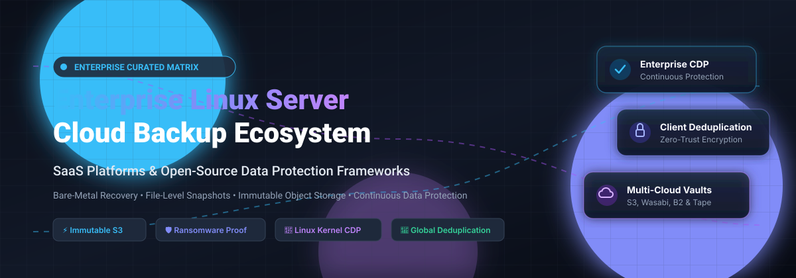

<div align="center">



# 🛡️ Awesome Enterprise Linux Server Cloud Backup 🐧

<p align="center">
  <a href="https://github.com/ishandutta2007/Awesome-Awesome-Awesome"></a><a href="https://discord.gg/jc4xtF58Ve"></a>
  <a href="https://github.com/ishandutta2007/Awesome-Enterprise-Linux-Server-Cloud-Backup/stargazers"></a>
  <a href="https://github.com/ishandutta2007/Awesome-Enterprise-Linux-Server-Cloud-Backup/network/members"></a>
  <a href="https://github.com/ishandutta2007/Awesome-Enterprise-Linux-Server-Cloud-Backup/blob/main/LICENSE"></a>
  <a href="https://github.com/ishandutta2007"></a>
</p>

<p align="center">
  <strong>Curated Directory of Enterprise Linux Server Cloud Backup Ecosystems, SaaS Platforms & Open-Source Projects</strong><br/>
  <em>Covering Bare-Metal Disaster Recovery, Continuous Data Protection (CDP), Deduplicated Object Storage & Enterprise Catalog Management</em>
</p>

---

</div>

## 📑 Table of Contents
- [🌐 Sector Overview & Market Dynamics](#-sector-overview--market-dynamics)
- [☁️ SaaS & Enterprise Cloud Backup Platforms](#️-saas--enterprise-cloud-backup-platforms)
- [🔓 Open-Source GitHub Projects](#-open-source-github-projects)
- [🛠️ Architectural Patterns & Deployment Strategy](#️-architectural-patterns--deployment-strategy)
- [🤝 How to Contribute](#-how-to-contribute)
- [💖 Support & Sponsorship](#-support--sponsorship)
- [📈 Star History](#-star-history)
- [⚖️ Disclaimer](#-disclaimer)

---

## 🌐 Sector Overview & Market Dynamics

The enterprise cloud backup and cyber-recovery sector represents an estimated **$7.5B to $8.7B** market today, accelerating toward **$40B+ by the mid-2030s** at an annual growth rate of 22%–25%. The industry exhibits a **hybrid market structure**: it is **concentrated at the top**—dominated by billion-dollar leaders (Veeam, Cohesity/Veritas, Commvault, Dell) offering unified ransomware immutability and multi-cloud compliance suites—while remaining **moderately fragmented across the edge and mid-market**, where specialized Linux agent providers, MSP point-solutions, and open-source self-hosted ecosystems thrive.

---

## ☁️ SaaS & Enterprise Cloud Backup Platforms

The table below compiles leading commercial platforms and SaaS products protecting Linux server fleets, ranked in **descending order by company valuation/revenue**.

| Product | Company Size (Valuation / Revenue) | Description | Starting Pricing (Specific Tier) | Free Tier / Free Trial Limits |
| :--- | :--- | :--- | :--- | :--- |
| **[Veeam Agent for Linux](https://www.veeam.com/)** | **$15B Valuation** / **$1.7B ARR** | Enterprise-grade physical and cloud Linux server agent. Delivers snapshot-based backups, database-aware pre/post freeze scripts, and direct multi-cloud replication. | **$95.00/server/year** (~$7.92/server/month, Essentials tier upfront commitment for up to 50 workloads) | **Free Forever Edition**: Unrestricted single standalone agent file-level backups (without central VBR orchestration); **30-Day Free Trial** for full Enterprise Data Platform features |
| **[Druva Data Resiliency Cloud](https://www.druva.com/)** | **$2B Valuation** / **$200M+ ARR** | 100% SaaS-native data protection built on AWS. Backs up Linux endpoints, enterprise databases, and NAS shares with global target deduplication and air-gapped immutable storage. | **$170.00/TB/month** (Business Edition base credit pack for enterprise server workloads) | **30-Day Free Trial**: Full SaaS evaluation including cloud storage quota and automated workload discovery (no credit card required) |
| **[R1Soft Server Backup Manager](https://www.r1soft.com/)** | **Part of ConnectWise (~$500M+ Revenue)** | Continuous Data Protection (CDP) using a custom kernel driver for sub-15 minute block-level recovery points. Includes cPanel, Plesk, and MySQL hot backup agents. | **$14.00/machine/month** (standard base protected Linux server license, billed monthly) | **14-Day Free Trial**: Fully functional evaluation license of Server Backup Manager and Linux CDP agent |
| **[SEP sesam](https://www.sepsoftware.com/)** | **Mid-Market Enterprise (~$20M+ Revenue)** | Hybrid enterprise backup suite from Germany specializing in Linux, SAP, Oracle, and complex multi-hypervisor estates. Features Si3 inline source/target deduplication and tape management. | **€1,985.00 perpetual** (Advanced Server base tier including 25 concurrent backup streams) | **30-Day Free Trial**: Complete installation bundle with demo license and evaluation support |

---

## 🔓 Open-Source GitHub Projects

Self-hosted open-source software provides organizations with total data sovereignty, zero vendor lock-in, and immunity against per-TB licensing fees. The projects below are ranked in **descending order by GitHub stargazers count**.

| Project | GitHub Stars | Description | Core Capabilities |
| :--- | :--- | :--- | :--- |
| **[Rclone](https://github.com/rclone/rclone)** | [](https://github.com/rclone/rclone/stargazers) | **The Swiss army knife of cloud storage sync.** High-performance multi-threaded CLI synchronizing Linux files to over 70 cloud object providers with client-side encryption. | Multi-cloud sync, on-the-fly encryption, bandwidth throttling, FUSE mount |
| **[Restic](https://github.com/restic/restic)** | [](https://github.com/restic/restic/stargazers) | **Fast, secure, and authenticated backup program.** Single static Go binary implementing encrypted, deduplicated chunk storage with native S3, SFTP, and B2 backends. | Always-on AES-256 encryption, content-defined chunk deduplication, zero daemon |
| **[Duplicati](https://github.com/duplicati/duplicati)** | [](https://github.com/duplicati/duplicati/stargazers) | **Encrypted block-based backup system with web UI.** Stores encrypted incremental backups across standard cloud storage protocols and WebDAV. | Built-in web dashboard, GPG/AES encryption, automated retention schedules |
| **[Kopia](https://github.com/kopia/kopia)** | [](https://github.com/kopia/kopia/stargazers) | **Next-gen fast and secure cross-platform backup tool.** Features zero-knowledge client encryption, content-addressable deduplication, and an optional repository server for centralized fleets. | CLI & GUI, multi-user repository server, zero-knowledge encryption, snapshot policies |
| **[BorgBackup](https://github.com/borgbackup/borg)** | [](https://github.com/borgbackup/borg/stargazers) | **Deduplicating archiver with authenticated encryption.** Legendary efficiency for server-to-server backups over SSH; archives can be mounted natively as virtual filesystems via FUSE. | Chunk-level deduplication, authenticated crypto, FUSE archive mounting |
| **[Velero](https://github.com/velero-io/velero)** | [](https://github.com/velero-io/velero/stargazers) | **Cloud-native disaster recovery for Kubernetes workloads.** Backs up cluster state and persistent Linux block volumes across major public cloud providers. | K8s resource backup, PV snapshotting, cluster migration, automated DR |
| **[bup](https://github.com/bup/bup)** | [](https://github.com/bup/bup/stargazers) | **Highly efficient Git packfile-based backup system.** Uses the Git packfile format and rolling checksums to handle giant virtual machine raw disk images and file systems efficiently. | Git packfile backend, rolling checksum deduplication, parity-based error repair |
| **[borgmatic](https://github.com/borgmatic-collective/borgmatic)** | [](https://github.com/borgmatic-collective/borgmatic/stargazers) | **Production automation wrapper for BorgBackup.** Unifies retention rules, pre/post execution hooks, database dumps (PostgreSQL/MySQL), and alerting monitors into a clean YAML configuration. | YAML config orchestration, automatic DB dumping, append-only security, healthchecks |
| **[BackupPC](https://github.com/backuppc/backuppc)** | [](https://github.com/backuppc/backuppc/stargazers) | **High-performance enterprise network backup suite.** Agentless architecture utilizing SSH/rsync/tar to centralize server disk backups with cross-client pooling and compression. | Agentless SSH/rsync client backups, server-side hardlink pool pooling, web GUI |
| **[Bareos](https://github.com/bareos/bareos)** | [](https://github.com/bareos/bareos/stargazers) | **Open-source enterprise network backup and catalog system.** AGPLv3 fork of Bacula with modern REST/web management, tape autochanger control, and client-director orchestration. | Centralized catalog, tape autochanger automation, storage migration tiers |
| **[ReaR (Relax-and-Recover)](https://github.com/rear/rear)** | [](https://github.com/rear/rear/stargazers) | **The leading Linux bare-metal disaster recovery framework.** Produces bootable rescue media (ISO/PXE/USB) and restores systems to dissimilar bare metal or virtualized targets. | Bare-metal recovery (BMR), automated boot media creation, LVM/storage remapping |
| **[UrBackup Server](https://github.com/uroni/urbackup_backend)** | [](https://github.com/uroni/urbackup_backend/stargazers) | **Client/server backup system combining file and image backups.** Delivers continuous live image snapshots on Linux servers (via dattobd or LVM) with web-controlled central administration. | Live raw disk image snapshots, btrfs/ZFS deduplication, web administration console |
| **[ElkarBackup](https://github.com/elkarbackup/elkarbackup)** | [](https://github.com/elkarbackup/elkarbackup/stargazers) | **Open-source web-based backup solution based on rsync and Rsnapshot.** Provides an intuitive interface for enterprise backup scheduling across Linux infrastructure. | Central web dashboard, automated rsync jobs, custom snapshot scripts |
| **[Amanda Community](https://github.com/zmanda/amanda)** | [](https://github.com/zmanda/amanda/stargazers) | **The classic Unix/Linux network backup system.** In production since the 1990s, using standard OS utilities (dump/tar) to back up heterogeneous Linux fleets to disk, tape, or cloud storage. | Smart backup scheduling, native OS tar/dump usage, tape library management |

---

## 🛠️ Architectural Patterns & Deployment Strategy

When architecting a Linux server cloud backup solution, choose between three primary operational models:

```
┌────────────────────────────────────────────────────────────────────────┐
│                   LINUX BACKUP ARCHITECTURAL MODELS                    │
├──────────────────────────┬───────────────────────┬─────────────────────┤
│   Lightweight CLI Model  │ Enterprise Suite Mode │  Bare-Metal (BMR)   │
│  (Restic / Borg / Kopia) │   (Bareos / Amanda)   │       (ReaR)        │
├──────────────────────────┼───────────────────────┼─────────────────────┤
│ • Zero central daemon    │ • Central SQL catalog │ • Restores kernel,  │
│ • Direct S3 / SSH push   │ • Multi-client agents │   partition table & │
│ • Client deduplication   │ • Tape library engine │   LVM configurations│
│ • Cron / Timer scheduled │ • Corporate compliance│ • Dissimilar target │
└──────────────────────────┴───────────────────────┴─────────────────────┘
```

1. **Client-Side Deduplication & Direct Push (e.g., Restic, Kopia):** Ideal for cloud-native Linux environments. Each server pushes encrypted chunks directly to Amazon S3, Backblaze B2, or Wasabi with zero intermediary servers.
2. **Central Director & Storage Catalog (e.g., Bareos, BackupPC):** Recommended for regulated enterprises managing on-premises tape, disk tiers, and compliance audit histories across hundreds of hosts.
3. **Bare-Metal Disaster Recovery (e.g., ReaR, R1Soft):** Essential for production mission-critical database and application servers requiring sub-hour full restoration directly from physical hardware failure.

---

## 🤝 How to Contribute

Contributions are warmly welcomed! To suggest a new open-source project or SaaS platform:

1. 🍴 Fork the repository.
2. 📝 Add your entry under the respective table adhering strictly to existing sorting rules and formatting standards.
3. 🏷️ Ensure all pricing and free trial limits are explicitly stated with exact numbers.
4. 🚀 Submit a Pull Request with a succinct explanation of the project's enterprise credentials.

---

## 💖 Support & Sponsorship

Thank you so much for exploring and using this curated resource! If you find this directory valuable for your organization, infrastructure designs, or daily sysadmin workflow, please consider supporting the project:

- ⭐ **Star this repository** to help others discover it across GitHub.
- 🍴 **Fork and contribute** new tools, benchmarks, and updates.
- 📢 **Share with fellow DevOps engineers**, SREs, and Linux system administrators.
- ☕ **Buy me a coffee / Sponsor**: Support ongoing maintenance, deep research, and updates via the [GitHub Sponsors Dashboard](https://github.com/sponsors/ishandutta2007).

<p align="left">
  <a href="https://github.com/sponsors/ishandutta2007">
    
  </a>
</p>

---

## 📈 Star History

[](https://www.star-history.com/#ishandutta2007/Awesome-Enterprise-Linux-Server-Cloud-Backup&type=date&legend=top-left)

---

## ⚖️ Disclaimer

- This is a community-curated directory intended for educational and architectural planning purposes.
- Always store encryption keys and passphrases in an off-site, air-gapped vault independent of backup storage.
- Regularly perform bare-metal test restores: *untested backups are strictly unverified recovery points.*

---

<div align="center">
  <sub>Maintained with ❤️ for DevOps engineers, SREs, and Linux Systems Administrators worldwide.</sub>
</div>
